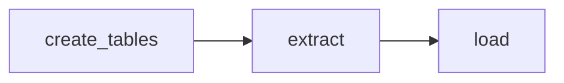

# Tahap 2: Ingestion Strava

## Tujuan

Mengambil aktivitas dari Strava API setiap hari, menyimpannya mentah, dan memuatnya ke tabel `raw.strava_activities` dengan cara yang **incremental** dan **idempotent**.

## Alur DAG `strava_ingest`



| Task | Yang dilakukan |
|---|---|
| `create_tables` | Membuat `raw.strava_activities` dan `raw.strava_auth` kalau belum ada |
| `extract` | Menukar refresh token dengan access token, mengambil aktivitas baru, menulis JSON mentah ke `data/raw/strava/<tahun>/<bulan>/<tanggal>/activities_<jam>.json`, lalu mengembalikan path file-nya |
| `load` | Membaca file itu dan melakukan upsert ke `raw.strava_activities` |

Jadwal `@daily`, `catchup=False`, dan `retries=2` dengan jeda 5 menit.

## Tabel

`raw.strava_activities`

| Kolom | Tipe | Keterangan |
|---|---|---|
| `activity_id` | `BIGINT` PK | ID aktivitas dari Strava |
| `start_date` | `TIMESTAMPTZ` | Waktu mulai (UTC) |
| `sport_type` | `TEXT` | Jenis aktivitas (`Run`, `WeightTraining`, dst.) |
| `payload` | `JSONB` | Respons Strava apa adanya |
| `ingested_at` | `TIMESTAMPTZ` | Kapan baris ini terakhir dimuat |

`raw.strava_auth` menyimpan satu baris (`id = 1`) berisi refresh token terbaru.

## Autentikasi (OAuth2)

Strava memakai dua token:

- **Access token**: dipakai memanggil API, berlaku sekitar 6 jam.
- **Refresh token**: berumur panjang, dipakai untuk meminta access token baru.

Setiap kali `extract` berjalan, kode menukar refresh token dengan access token baru. Strava dapat mengeluarkan refresh token baru pada penukaran itu, sehingga token terbaru disimpan di `raw.strava_auth`. Urutan pembacaannya: **database dulu, `.env` hanya sebagai token pertama**. Akibatnya, kalau token diganti di `.env` (misalnya setelah otorisasi ulang), baris lama di `raw.strava_auth` harus dihapus:

```bash
docker compose exec warehouse-db sh -c "psql -U $POSTGRES_USER -d $POSTGRES_DB -c 'DELETE FROM raw.strava_auth;'"
```

### Mendapatkan refresh token pertama

Dilakukan sekali, secara manual.

1. Buka di browser (ganti `CLIENT_ID`):
   ```
   https://www.strava.com/oauth/authorize?client_id=CLIENT_ID&response_type=code&redirect_uri=http://localhost&approval_prompt=force&scope=read,activity:read_all
   ```
2. Pastikan semua kotak izin tercentang, lalu klik **Authorize**. Browser diarahkan ke `http://localhost/?code=...` dan halamannya menampilkan error. Itu normal; salin nilai `code` dari address bar dan pastikan di ujung URL ada `scope=read,activity:read_all`.
3. Tukar `code` dengan token (kode berlaku singkat dan hanya sekali pakai):
   ```bash
   curl -X POST https://www.strava.com/oauth/token -d client_id=CLIENT_ID -d client_secret=CLIENT_SECRET -d code=KODE_DARI_URL -d grant_type=authorization_code
   ```
4. Simpan `refresh_token` dari respons ke `STRAVA_REFRESH_TOKEN` di `.env`, lalu muat ulang container:
   ```bash
   docker compose up -d --force-recreate airflow-webserver airflow-scheduler
   ```

Scope `activity:read_all` wajib. Tanpa scope itu Strava membalas `401 Unauthorized` saat daftar aktivitas dibaca, walaupun token valid untuk refresh.

## Incremental load

`extract` mengambil `max(start_date)` dari tabel, mengurangi **3 hari** (`LOOKBACK_DAYS`), lalu memakainya sebagai parameter `after` ke Strava. Aktivitas yang diedit dalam 3 hari terakhir ikut terambil ulang dan memperbarui barisnya. Kalau tabel masih kosong, `after = 0`, sehingga run pertama menjadi *backfill* seluruh riwayat.

API Strava mengembalikan data per halaman. Kode meminta `per_page=200` (batas maksimum) dan terus meminta halaman berikutnya sampai halaman kosong.

## Idempotency

`load` memakai:

```sql
INSERT ... ON CONFLICT (activity_id) DO UPDATE SET ...
```

Menjalankan DAG berulang kali menghasilkan jumlah baris yang sama.

## Verifikasi

```bash
docker compose exec warehouse-db sh -c "psql -U $POSTGRES_USER -d $POSTGRES_DB -c 'SELECT count(*), min(start_date), max(start_date) FROM raw.strava_activities;'"
```

1. Jumlah baris sama dengan jumlah aktivitas di akun Strava (semua jenis).
2. Trigger DAG sekali lagi, lalu jalankan query yang sama: `count` tidak boleh bertambah.
3. Tes `extract` tanpa menunggu retry Airflow:
   ```bash
   docker compose exec airflow-scheduler airflow tasks test strava_ingest extract 2026-01-01
   ```

## Batasan

- Batas API Strava untuk aplikasi baru: sekitar 100 request per 15 menit dan 1.000 per hari. Untuk satu akun, ini lebih dari cukup.
- Pipeline memakai satu token milik penulis. Mendukung banyak pengguna butuh token per pengguna dan kolom `athlete_id` di semua tabel; itu di luar cakupan versi ini.

## File terkait

| File | Isi |
|---|---|
| `dags/strava_ingest.py` | Definisi DAG dan tiga task |
| `include/strava_client.py` | Refresh token, simpan token, ambil aktivitas |
| `include/db.py` | Koneksi Postgres dan DDL tabel raw |