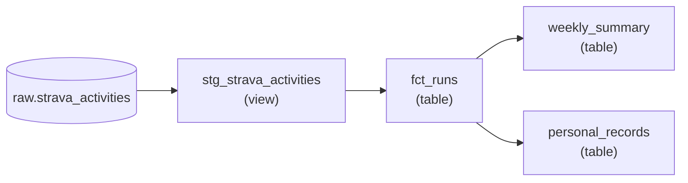

# Tahap 3: Transformasi dbt

## Tujuan

Mengubah JSON mentah di `raw` menjadi tabel analitik yang siap dipakai dashboard, dengan test kualitas data yang dijalankan di setiap build.

## Lineage



## Model

| Model | Schema | Materialisasi | Isi |
|---|---|---|---|
| `stg_strava_activities` | `staging` | view | Satu baris per aktivitas (semua jenis). Field JSON dipecah ke kolom bertipe: jarak (m), waktu bergerak (detik), elevasi, kecepatan, detak jantung |
| `fct_runs` | `marts` | table | Hanya `Run` dan `TrailRun` dengan jarak dan waktu lebih dari nol. Jarak dalam km, pace (menit/km), tanggal lokal, awal minggu |
| `weekly_summary` | `marts` | table | Ringkasan per minggu (Senin sebagai awal minggu): jumlah lari, total km, total jam, pace rata-rata, lari terpanjang, elevasi |
| `personal_records` | `marts` | table | Pace tercepat per kelompok jarak: 5K, 10K, half marathon, marathon |

Staging sengaja ringan: hanya mengganti tipe, nama, dan satuan, tanpa logika bisnis dan tanpa memfilter jenis aktivitas. Filter lari dilakukan di `fct_runs`, sehingga analisis lain (gym, jalan kaki) bisa dibuat di atas staging yang sama.

## Konfigurasi

- **`dbt_project.yml`** mengatur materialisasi per folder (`staging` → view, `marts` → table) dan schema tujuannya. Kunci di bawah `models:` harus sama persis dengan `name:` proyek (`running_tracker`).
- **`profiles.yml`** membaca kredensial dari environment variable (`env_var(...)`), jadi tidak ada secret di file dan aman di-commit. Container Airflow sudah memuat variabelnya dari `.env`.
- **`macros/generate_schema_name.sql`**: perilaku bawaan dbt menggabungkan schema target dan schema custom (hasilnya `staging_marts`). Macro ini membuat dbt memakai nama schema custom apa adanya (`staging` dan `marts`).

## Test

| Test | Di mana | Jenis |
|---|---|---|
| `unique`, `not_null` pada `activity_id` | source, staging, `fct_runs` | Generik |
| `not_null` pada `started_at_local` | staging | Generik |
| `accepted_values` pada `sport_type` (`Run`, `TrailRun`) | `fct_runs` | Generik |
| `not_null` pada `distance_km`, `pace_min_per_km` | `fct_runs` | Generik |
| `unique`, `not_null` pada `week_start` | `weekly_summary` | Generik |
| `unique`, `not_null` pada `distance_bucket` | `personal_records` | Generik |
| Pace di antara 2:30 dan 15:00 per km | `tests/assert_run_pace_is_plausible.sql` | Singular, `severity: warn` |

Test pace hanya memberi peringatan karena data yang aneh (misalnya jalan kaki yang tercatat sebagai lari) tidak seharusnya menghentikan pipeline.

## Cara menjalankan

```bash
docker compose exec airflow-scheduler /home/airflow/dbt_venv/bin/dbt debug --project-dir /opt/airflow/dbt_project --profiles-dir /opt/airflow/dbt_project
docker compose exec airflow-scheduler /home/airflow/dbt_venv/bin/dbt run   --project-dir /opt/airflow/dbt_project --profiles-dir /opt/airflow/dbt_project
docker compose exec airflow-scheduler /home/airflow/dbt_venv/bin/dbt test  --project-dir /opt/airflow/dbt_project --profiles-dir /opt/airflow/dbt_project
```

- `dbt debug` memeriksa koneksi. Satu check yang gagal soal `git` bisa diabaikan: git hanya dibutuhkan untuk `dbt deps` (paket tambahan), dan proyek ini tidak memakainya. Yang penting `Connection test: OK`.
- `dbt run` yang benar berakhir dengan `Finished running 3 table models, 1 view model` dan `PASS=4`.

## Catatan perhitungan

- **Tanggal lokal.** `run_date` dan awal minggu dihitung dari `start_date_local`, bukan `start_date` (UTC), supaya lari jam 05:00 WIB tidak jatuh ke hari sebelumnya.
- **Pace mingguan** = total waktu ÷ total jarak, bukan rata-rata pace tiap lari.
- **`personal_records` adalah perkiraan.** Pengelompokan memakai jarak total aktivitas (lari 5,2 km masuk kelompok 5K). PR yang tepat, yaitu *best effort* 5K di dalam lari yang lebih panjang, butuh data `best_efforts` atau `splits` dari endpoint detail Strava, yang belum diambil.

## Verifikasi

```sql
select * from marts.weekly_summary order by week_start desc limit 5;
select * from marts.personal_records;
```

Bandingkan dengan Strava: jumlah lari dan total km minggu terakhir harus cocok.

## File terkait

`dbt_project/dbt_project.yml`, `profiles.yml`, `macros/generate_schema_name.sql`, `models/staging/`, `models/marts/`, `tests/`.