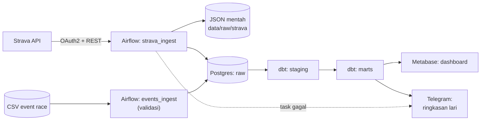

# Running Tracker

[](https://github.com/lazuadik/RunningTracker/actions/workflows/ci.yml)

Pipeline data end-to-end untuk menganalisis performa lari pribadi: aktivitas diambil dari **Strava API**, diorkestrasi dengan **Apache Airflow**, disimpan di **PostgreSQL**, ditransformasi dengan **dbt**, lalu ditampilkan di dashboard **Metabase**. Seluruh stack berjalan lokal lewat Docker Compose dan tidak membutuhkan biaya.

> Proyek belajar data engineering. Data yang dipakai adalah data aktivitas lari milik penulis sendiri.

<!-- Tambahkan screenshot dashboard setelah file-nya ada, lalu hapus tanda komentar ini:

-->

## Status

| Tahap | Isi | Status |
|---|---|---|
| 1 | Infrastruktur Docker Compose (Airflow, Postgres, Metabase) | ✅ |
| 2 | Ingestion Strava: incremental dan idempotent | ✅ |
| 3 | Transformasi dbt (staging → marts) dengan test | ✅ |
| 4 | Dashboard performa lari di Metabase | ✅ |
| 5 | Pipeline event race: CSV, validasi, `dim_events`, `race_readiness` | ✅ |
| 6 | dbt otomatis di Airflow, alert kegagalan dan ringkasan lari ke Telegram | ✅ |
| 6 | CI (GitHub Actions): ruff, pytest, `dbt parse`, cek struktur DAG | ✅ |
| – | Deploy ke VPS, webhook Strava (real-time) | ⬜ |

## Arsitektur



Data mengalir lewat tiga lapisan di satu warehouse PostgreSQL:

| Lapisan | Schema | Isi | Setara medallion |
|---|---|---|---|
| Mentah | `raw` | Payload JSON Strava apa adanya (`jsonb`) | Bronze |
| Bersih | `staging` | Kolom bertipe dan satuan dasar (meter, detik), semua jenis aktivitas | Silver |
| Siap pakai | `marts` | Hanya lari, sudah dihitung (km, pace), diringkas per minggu; daftar event dan kesiapannya | Gold |

Dashboard dan notifikasi hanya membaca schema `marts`. Polanya **ELT**: data mentah dimuat dulu ke warehouse, lalu ditransformasi di dalamnya dengan dbt.

## Tech stack

| Komponen | Pilihan | Peran |
|---|---|---|
| Orkestrasi | Apache Airflow 2.10 (LocalExecutor) | Menjadwalkan dan menjalankan DAG |
| Warehouse | PostgreSQL 16 | Penyimpanan raw, staging, marts |
| Transformasi | dbt (dbt-postgres) | Model SQL, test, dokumentasi kolom |
| Dashboard | Metabase | Visualisasi |
| Infrastruktur | Docker Compose | Menjalankan semua layanan secara lokal |
| Bahasa | Python 3.11 (`requests`, `psycopg2`) | Client Strava, loader, validasi event |
| Notifikasi | Telegram Bot API | Alert kegagalan dan ringkasan lari |
| Kualitas kode | `ruff`, `pytest`, GitHub Actions | Lint, unit test, `dbt parse`, cek struktur DAG |

## Struktur repo

```
.
├── docker-compose.yml          # Airflow, dua Postgres, Metabase
├── Dockerfile                  # Image Airflow + dbt (virtualenv terpisah)
├── init-warehouse.sql          # Membuat schema raw, staging, marts
├── .env.example                # Template variabel lingkungan (tanpa secret)
├── ruff.toml                   # Aturan lint
├── pytest.ini
├── .github/workflows/ci.yml    # CI: ruff, pytest, dbt parse, cek DAG
├── dags/
│   ├── strava_ingest.py        # extract → load → dbt_run → dbt_test → notify_run
│   └── events_ingest.py        # CSV event → raw.events → dbt (model event)
├── include/
│   ├── db.py                   # Koneksi dan DDL tabel raw
│   ├── strava_client.py        # OAuth refresh token + pengambilan aktivitas
│   ├── events.py               # Baca, validasi, dan upsert CSV event
│   ├── telegram.py             # send_telegram dan callback kegagalan
│   └── run_summary.py          # Menyusun dan mengirim ringkasan lari
├── dbt_project/
│   ├── dbt_project.yml
│   ├── profiles.yml            # Membaca kredensial dari environment variable
│   ├── macros/                 # generate_schema_name
│   ├── models/staging/         # stg_strava_activities, stg_events
│   ├── models/marts/           # fct_runs, weekly_summary, personal_records, dim_events, race_readiness
│   └── tests/                  # test singular
├── tests/                      # pytest: validasi event, struktur DAG
├── data/
│   ├── events/events_seed.csv  # Daftar event race (diedit manual)
│   └── raw/                    # JSON mentah dari Strava (tidak di-commit)
└── docs/                       # Dokumentasi per tahap
```

## Cara menjalankan

Prasyarat: Docker Desktop (alokasikan RAM minimal 4 GB), Git, dan akun Strava.

1. **Clone repo** lalu masuk ke foldernya.
2. **Buat aplikasi Strava** di `https://www.strava.com/settings/api` dengan *Authorization Callback Domain* `localhost`. Catat Client ID dan Client Secret.
3. **Siapkan `.env`**: salin `.env.example` menjadi `.env` (`copy .env.example .env` di Windows, `cp .env.example .env` di Mac/Linux), lalu isi nilainya. File `.env` sudah ada di `.gitignore`, jangan pernah di-commit.
4. **Ambil refresh token Strava** (sekali saja). Langkahnya ada di [docs/02-ingestion-strava.md](docs/02-ingestion-strava.md#mendapatkan-refresh-token-pertama).
5. **Jalankan stack**:
   ```bash
   docker compose build
   docker compose up -d
   ```
   Tunggu 1-3 menit sampai `docker compose ps` menunjukkan `airflow-webserver` berstatus `healthy`.
6. **Buka layanan**: Airflow di `http://localhost:8080` (login dengan `AIRFLOW_ADMIN_USER` dan `AIRFLOW_ADMIN_PASSWORD`), Metabase di `http://localhost:3000`. Kalau port 8080 sudah dipakai aplikasi lain, ubah mapping port di `docker-compose.yml` (misalnya `8081:8080`).
7. **Jalankan ingestion**: aktifkan DAG `strava_ingest` di Airflow lalu klik *Trigger DAG*. Task `create_tables`, `extract`, `load`, `dbt_run`, dan `dbt_test` harus hijau; `dbt_run` otomatis membangun semua model, jadi tidak perlu menjalankan dbt manual.
8. **(Opsional) Event race**: edit `data/events/events_seed.csv` dengan event yang kamu incar (format di [docs/05-event-race.md](docs/05-event-race.md)), lalu trigger DAG `events_ingest`.
9. **Telegram**: buat bot dan isi `TELEGRAM_BOT_TOKEN` serta `TELEGRAM_CHAT_ID` di `.env` ([docs/06-notifikasi-telegram.md](docs/06-notifikasi-telegram.md)). Langkah ini perlu kalau DAG dipakai apa adanya: tanpa kedua variabel itu task `notify_run` gagal. Kalau tidak mau notifikasi, hapus task `notify_run` dan `on_failure_callback` dari `dags/strava_ingest.py`.
10. **Hubungkan Metabase** ke warehouse dan buat dashboard. Lihat [docs/04-dashboard-metabase.md](docs/04-dashboard-metabase.md).

### Menjalankan tes

```bash
pip install ruff pytest psycopg2-binary requests
ruff check .
python -m pytest
```

Tes struktur DAG (`tests/test_dag_integrity.py`) butuh Airflow, jadi dijalankan di dalam container: `docker compose exec airflow-scheduler python -m pytest tests/test_dag_integrity.py`. Di mesin tanpa Airflow file itu dilewati otomatis, dan CI menjalankannya di job terpisah.

## Keputusan desain

| Keputusan | Alasan |
|---|---|
| Payload Strava disimpan mentah sebagai `jsonb` di `raw` | Perubahan atau tambahan field dari Strava tidak merusak ingestion; kolom dipecah di dbt, jadi bisa dihitung ulang kapan saja |
| Upsert berdasarkan `activity_id` (`ON CONFLICT DO UPDATE`) | Idempotent: menjalankan DAG dua kali tidak membuat data ganda |
| Incremental load dengan `lookback` 3 hari | Hanya mengambil aktivitas baru, tetapi tetap menangkap aktivitas yang diedit setelah diunggah |
| Refresh token terbaru disimpan di database | Strava dapat mengganti refresh token pada setiap pembaruan; membaca dari `.env` terus-menerus akan gagal suatu saat |
| Hanya path file JSON yang dikirim antar task Airflow | Menghindari data besar di XCom |
| Dua database Postgres terpisah (metadata Airflow dan warehouse) | Metadata orkestrasi tidak bercampur dengan data analitik |
| dbt di virtualenv terpisah dalam image Airflow | Menghindari konflik dependency dengan Airflow |
| Secret hanya lewat environment variable | `profiles.yml` dan `docker-compose.yml` aman di-commit |
| Pace mingguan = total waktu ÷ total jarak | Lebih akurat daripada merata-ratakan pace tiap lari, yang membuat lari pendek terlalu berpengaruh |

## Kualitas data

- **Test dbt**: `unique` dan `not_null` pada kunci, `accepted_values` pada jenis aktivitas, dan satu test singular yang memperingatkan lari dengan pace tidak masuk akal (di bawah 2:30 atau di atas 15:00 per km).
- **Ingestion idempotent**, dibuktikan dengan menjalankan DAG berulang kali tanpa perubahan jumlah baris.
- **Validasi event di pintu masuk**: baris CSV yang salah ditolak dengan alasan dan disimpan terpisah; satu baris buruk tidak menghentikan yang lain.
- **CI di setiap push dan pull request**: lint `ruff`, unit test `pytest`, `dbt parse`, dan pemeriksaan struktur DAG (tidak ada *Broken DAG*, `dbt_run` menunggu `load`).
- **Alert**: task yang gagal setelah semua retry mengirim pesan ke Telegram.

## Dokumentasi lanjutan

- [Tahap 1: Infrastruktur](docs/01-infrastruktur.md)
- [Tahap 2: Ingestion Strava](docs/02-ingestion-strava.md)
- [Tahap 3: Transformasi dbt](docs/03-transformasi-dbt.md)
- [Tahap 4: Dashboard Metabase](docs/04-dashboard-metabase.md)
- [Tahap 5: Event race dan kesiapan](docs/05-event-race.md)
- [Tahap 6: Alert dan notifikasi Telegram](docs/06-notifikasi-telegram.md)
- [Masalah yang ditemui dan solusinya](docs/troubleshooting.md)

## Roadmap

- Deploy ke VPS dan webhook Strava, supaya data masuk dan notifikasi terkirim begitu aktivitas selesai diunggah (real-time)
- DAG yang memproses satu `activity_id` (untuk webhook)
- Sumber data kedua untuk latihan beban (Strava API tidak menyediakan gerakan, set, dan beban), misalnya ekspor CSV dari aplikasi gym
- Dashboard publik dan dukungan banyak pengguna (butuh token per pengguna dan `athlete_id` di semua tabel)

## Catatan keamanan dan penggunaan data

- Jangan commit `.env`, token, atau Client Secret. Kalau secret pernah tampil di screenshot atau log, buat ulang di `strava.com/settings/api`.
- Proyek ini hanya memproses data akun penulis sendiri. Sebelum menampilkan data Strava ke pengguna lain, baca dahulu [Strava API Agreement](https://www.strava.com/legal/api).