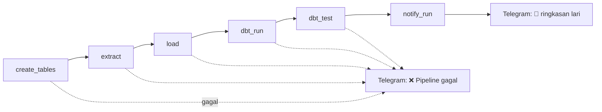

# Tahap 6: Alert dan notifikasi Telegram

## Tujuan

- **Alert kegagalan:** kalau task di DAG mana pun gagal (misalnya token Strava kedaluwarsa), pesan langsung masuk ke Telegram, tanpa perlu membuka Airflow.
- **Ringkasan lari:** setelah data baru masuk dan lolos test, kirim ringkasan lari terbaru, mileage minggu ini, dan status kesiapan event.

Telegram dipilih karena gratis dan tidak butuh persetujuan template seperti WhatsApp Business API. Pengirimnya hanya satu fungsi, `send_telegram`, jadi bisa diganti ke kanal lain tanpa mengubah DAG.

## Alur `strava_ingest`



`dbt_run` bergantung pada `load`, dan `notify_run` pada `dbt_test`. Dengan begitu pesan ringkasan hanya terkirim kalau data baru sudah dimuat dan test kualitas lulus. Urutan ini dijaga oleh `tests/test_dag_integrity.py`.

## Menyiapkan bot

1. Di Telegram, chat dengan `@BotFather`, kirim `/newbot`, dan ikuti petunjuknya. Simpan token yang diberikan.
2. Kirim satu pesan apa saja ke bot barumu.
3. Buka `https://api.telegram.org/bot<TOKEN>/getUpdates` di browser dan cari `"chat":{"id":...`. Angka itu `chat_id`.
4. Simpan di `.env` (tidak pernah di kode atau di chat):
   ```
   TELEGRAM_BOT_TOKEN=...
   TELEGRAM_CHAT_ID=...
   ```
5. Muat ulang container: `docker compose up -d --force-recreate airflow-webserver airflow-scheduler`.
6. Uji:
   ```bash
   docker compose exec airflow-scheduler python -c "from include.telegram import send_telegram; send_telegram('tes dari pipeline')"
   ```

Token bot setara password. Kalau pernah tampil di chat, screenshot, atau log, cabut dengan `/revoke` ke `@BotFather` dan pakai token baru.

## Komponen

| File | Isi |
|---|---|
| `include/telegram.py` | `send_telegram(text)` dan `notify_failure(context)` (callback kegagalan Airflow) |
| `include/run_summary.py` | `build_run_summary()` menyusun teks dari tabel `marts`; `notify_if_new_run(send)` mengirimnya sekali per lari |

## Alert kegagalan

`notify_failure` dipasang sebagai `on_failure_callback` di `default_args` kedua DAG, jadi berlaku untuk semua task. Callback hanya jalan setelah **semua retry habis**. Dengan `retries=3` dan jeda 5 menit, pesan datang sekitar 15 menit setelah kegagalan pertama, sehingga gangguan sementara tidak membanjiri chat.

## Ringkasan lari dan pencegah duplikat

Isi pesan diambil dari tiga tabel `marts`: lari terbaru (`fct_runs`), total minggu ini (`weekly_summary`), dan event terdekat (`race_readiness`). Bagian event dilewati kalau tidak ada event mendatang.

Karena DAG berjalan `@daily`, tanpa penjagaan lari yang sama akan dikabarkan ulang tiap hari. Tabel `raw.notifications_log (activity_id, sent_at)` mencatat lari yang sudah dikabarkan:

1. Ambil `activity_id` lari terbaru dari `marts.fct_runs`.
2. Kalau sudah ada di log, selesai tanpa mengirim.
3. Kalau belum, kirim pesan, **baru** catat di log.

Mengirim lebih dulu daripada mencatat disengaja: kalau pengiriman gagal, lari itu tidak tercatat dan dicoba lagi pada run berikutnya. Risikonya terbalik hanya kalau pencatatan gagal setelah pesan terkirim (duplikat), yang jauh lebih jarang.

Untuk mengulang uji, kosongkan log lewat psql: `delete from raw.notifications_log;`.

## Batasan

- Pesan datang saat DAG berjalan (harian atau saat di-*trigger*), belum real-time. Real-time butuh webhook Strava dan server yang menyala terus; itu bagian dari tahap deploy ke VPS.
- Strava tidak menyediakan detail latihan beban (gerakan, set, repetisi) lewat API, jadi ringkasan hanya mencakup lari.